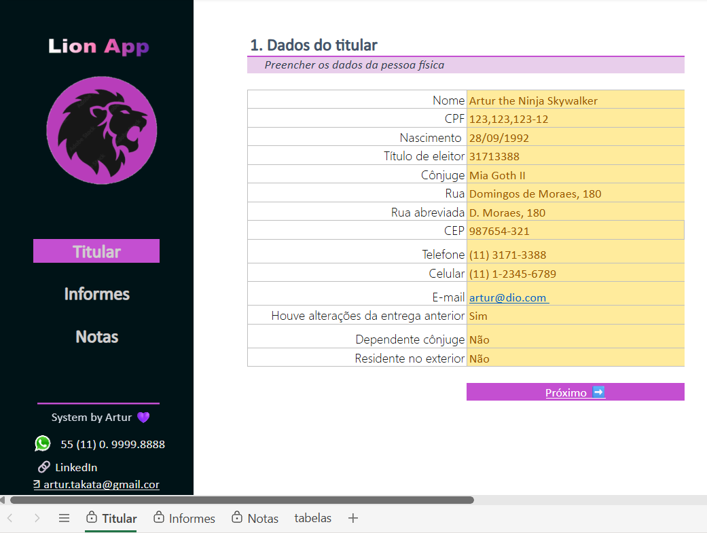
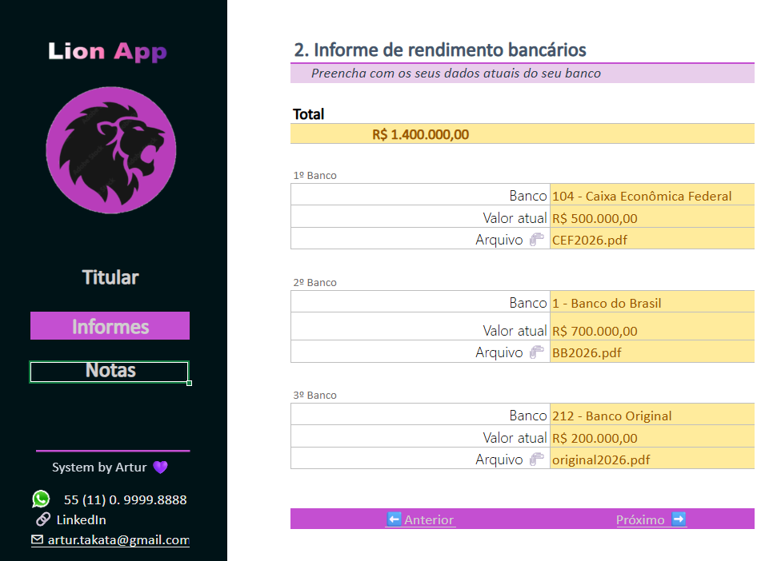
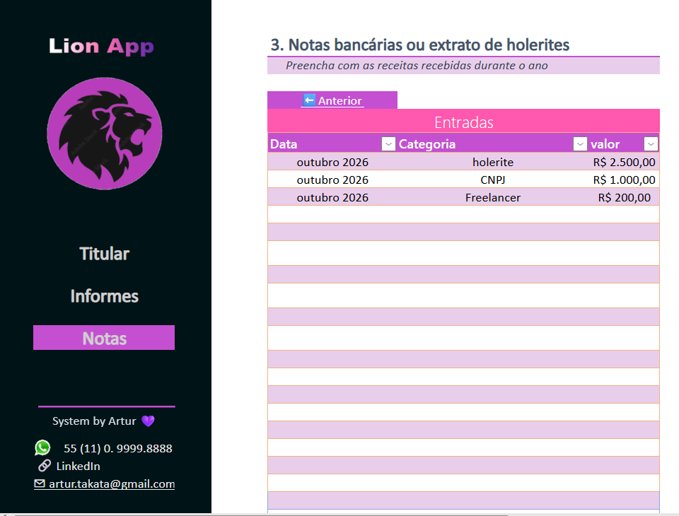

# 📊 Organizador de Imposto de Renda no Excel

## 📖 Sobre o Projeto

Este projeto foi desenvolvido como parte do desafio prático da DIO (Digital Innovation One), com o objetivo de criar uma ferramenta em Excel para auxiliar na organização das informações necessárias para a declaração do Imposto de Renda.

A solução funciona como um agregador de dados, permitindo o registro e consulta de informações importantes de forma centralizada, organizada e intuitiva.

Além de aplicar conceitos de Excel, o projeto também teve como foco a documentação técnica e o compartilhamento da solução através do GitHub.

---

## 🎯 Objetivos

A ferramenta foi criada para:

- Organizar informações do titular da declaração;
- Controlar informes de rendimentos bancários;
- Registrar receitas e lançamentos financeiros;
- Facilitar a navegação entre as áreas da planilha;
- Utilizar validações para reduzir erros de preenchimento;
- Centralizar as informações necessárias para a declaração anual.

---

## 🏗️ Estrutura do Projeto

A pasta de trabalho é composta pelas seguintes abas:

### 👤 Titular

Área destinada ao cadastro das informações do contribuinte:

- Nome
- CPF
- Data de nascimento
- Título de eleitor
- Dados do cônjuge
- Endereço
- Contatos
- Observações complementares

---

### 🏦 Informes

Área para controle dos informes bancários.

Permite registrar:

- Instituição financeira
- Saldo ou valor informado
- Arquivo de comprovante
- Totalização dos valores declarados

Também utiliza listas de seleção para facilitar o preenchimento dos bancos cadastrados.

---

### 💰 Notas

Área destinada ao registro de receitas e rendimentos recebidos ao longo do ano.

Exemplos:

- Holerites
- Trabalhos freelancers
- Outras fontes de receita

---

### 📋 Tabelas de Apoio

Contém as tabelas auxiliares utilizadas nas validações da planilha, como a lista de instituições financeiras.

---

## ✨ Funcionalidades Implementadas

- ✅ Navegação entre abas
- ✅ Validação de dados
- ✅ Listas suspensas (drop-down)
- ✅ Organização de informações para IR
- ✅ Estrutura amigável para preenchimento
- ✅ Centralização de documentos e referências
- ✅ Controle de informações bancárias
- ✅ Registro de receitas e rendimentos

---

## ⚠️ Adaptação para Excel Web

O conteúdo do curso foi desenvolvido utilizando o **Microsoft Excel Desktop**, porém meu ambiente de desenvolvimento foi o **Excel para Web**.

Durante o desenvolvimento encontrei algumas limitações da versão online, entre elas:

- Ausência de suporte completo para VBA;
- Limitações no tratamento de formas (Shapes);
- Restrições em hyperlinks associados a formas;
- Diferenças no posicionamento e alinhamento de elementos gráficos;
- Falta de algumas propriedades disponíveis na versão Desktop, como:
  - "Não mover ou dimensionar com células";
  - Configurações avançadas de objetos;
  - Determinados recursos de interface.

Por conta dessas limitações, algumas adaptações foram necessárias.

### 🔧 Exemplo de adaptação

No projeto original, os menus de navegação eram construídos utilizando formas com hyperlinks associados.

Como o Excel Web possui restrições nesse recurso, foi necessário improvisar a implementação dos botões de navegação para manter uma experiência de uso semelhante à apresentada nas aulas.

Apesar dessas limitações, foi possível reproduzir a proposta do desafio e manter as funcionalidades essenciais da ferramenta.

---

## 🛠️ Tecnologias Utilizadas

- Microsoft Excel Online (Excel Web)
- Git
- GitHub
- Markdown

---

## 📚 Aprendizados

Durante o desenvolvimento deste projeto foi possível praticar:

- Organização de dados em Excel;
- Criação de validações de entrada;
- Estruturação de ferramentas para uso cotidiano;
- Documentação técnica com Markdown;
- Versionamento de projetos utilizando Git e GitHub;
- Adaptação de soluções diante das limitações de plataforma.

---

## 📸 Demonstração
### Dados do Titular

### Dados dos Informes de Rendimento

### Holerite e recebimento como CNPJ e Freelancer

---

## 🚀 Como Utilizar

1. Abra o arquivo Excel do projeto;
2. Preencha os dados do titular;
3. Adicione os informes bancários;
4. Registre os rendimentos recebidos durante o ano;
5. Utilize as abas para navegar entre as informações;
6. Utilize os dados organizados como apoio para a declaração do Imposto de Renda.

---

## 👨‍💻 Autor

Desenvolvido como projeto prático da DIO.

Projeto realizado para fins educacionais e de aprendizado em Excel, documentação técnica e GitHub.
